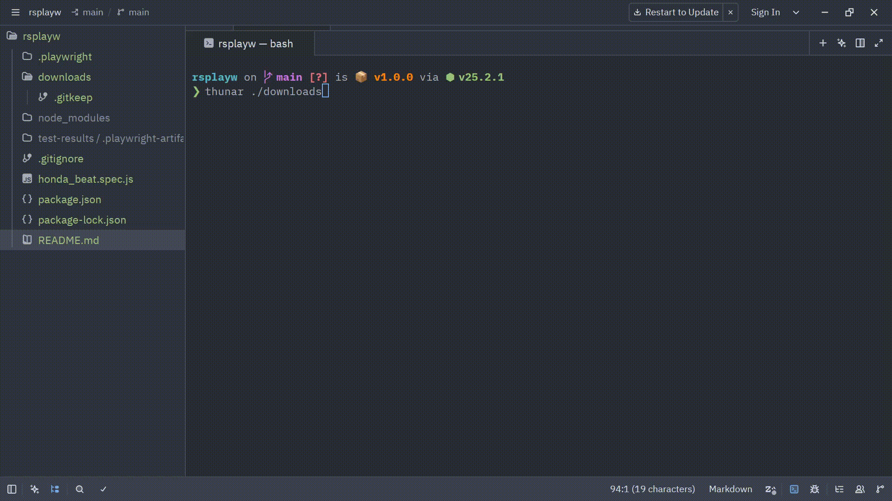

# 🚀 demo-automate — Playwright Automation & Test Suite

[](LICENSE)
[](https://playwright.dev/)

Repositori ini berisi script pengujian otomatis (End-to-End / E2E) dan automasi web menggunakan [Playwright](https://playwright.dev/). Saat ini repositori memiliki script automasi untuk mengunduh e-brosur motor (Honda BeAT) dari situs resmi Astra Honda ke direktori lokal `downloads/`.

<p align="center">
  
</p>

---

## 📋 Daftar Isi
1. [Prasyarat Sistem](#-prasyarat-sistem)
2. [Instalasi & Setup Awal](#-instalasi--setup-awal)
3. [Cara Menjalankan Script](#-cara-menjalankan-script)
   - [Tabel Perintah Cepat](#tabel-perintah-cepat)
   - [1. Mode Default (Headless / Cepat di Balik Layar)](#1-mode-default-headless)
   - [2. Mode Headed (Melihat Jendela Browser Terbuka)](#2-mode-headed-melihat-browser-terbuka)
   - [3. Mode Interaktif UI (Playwright Test Runner UI)](#3-mode-interaktif-ui)
   - [4. Mode Debug (Playwright Inspector)](#4-mode-debug-playwright-inspector)
   - [5. Melihat Laporan Hasil Test (HTML Report)](#5-melihat-laporan-hasil-test)
   - [6. Merekam Script Baru (Playwright Codegen)](#6-merekam-script-baru-codegen)
4. [Penjelasan Alur Script `honda_beat.spec.js`](#-penjelasan-alur-script-honda_beatspecjs)
5. [Struktur Direktori Proyek](#-struktur-direktori-proyek)
6. [Troubleshooting & Solusi Kendala](#-troubleshooting--solusi-kendala)
7. [Disclaimer](#-disclaimer)
8. [Lisensi (License)](#-lisensi-license)

---

## 💻 Prasyarat Sistem

Sebelum memulai, pastikan perangkat Anda telah terpasang:
- **Node.js**: Versi `>= 18.0.0` (disarankan Node LTS seperti v20+ atau v22+).
  - Cek versi: `node -v`
- **npm**: Versi `>= 9.0.0`.
  - Cek versi: `npm -v`
- Koneksi internet aktif untuk mengunduh brosur dari server website tujuan.

---

## ⚙️ Instalasi & Setup Awal

Jika Anda baru pertama kali meng-clone repositori ini, jalankan langkah-langkah berikut di terminal:

```bash
# 1. Kloning repositori & masuk ke direktori
git clone https://github.com/mnurfaadil/demo-automate.git
cd demo-automate

# 2. Pasang dependensi Node.js
npm install

# 3. Pasang browser engine Playwright (Chromium)
npx playwright install chromium
```

> 💡 **Khusus Pengguna Linux (Ubuntu/Debian):** Jika Anda mengalami kendala library sistem yang kurang, pasang library pendukung dengan:
> ```bash
> npx playwright install-deps
> ```

---

## 🏃 Cara Menjalankan Script

### Tabel Perintah Cepat

| Perintah NPM | Perintah Alternatif (NPX) | Keterangan |
| :--- | :--- | :--- |
| `npm test` | `npx playwright test` | Menjalankan seluruh test dalam mode **Headless** (tanpa GUI) |
| `npm run test:headed` | `npx playwright test --headed` | Menjalankan test dengan **browser terbuka** (GUI terlihat) |
| `npm run test:ui` | `npx playwright test --ui` | Membuka antarmuka interaktif **Playwright UI** |
| `npm run test:debug` | `npx playwright test --debug` | Menjalankan test dalam mode **step-by-step debug** |
| `npm run test:report` | `npx playwright show-report` | Membuka laporan HTML hasil eksekusi terakhir |
| `npm run codegen` | `npx playwright codegen <URL>` | Generator kode otomatis via rekaman klik browser |

---

### 1. Mode Default (Headless)
Mode ini mengeksekusi test di latar belakang tanpa membuka jendela browser. Sangat cepat dan cocok digunakan di terminal lokal maupun server CI/CD.

```bash
npm test
```
*Atau jalankan file spesifik:*
```bash
npx playwright test honda_beat.spec.js
```

**Hasil eksekusi:**
- Script akan mengunduh file brosur PDF dan menyimpannya di folder `downloads/`.
- Terminal akan menampilkan status `✓ 1 passed` beserta path lokasi file yang tersimpan.

---

### 2. Mode Headed (Melihat Browser Terbuka)
Gunakan mode ini jika Anda ingin melihat langsung proses otomasi di layar (bagaimana Playwright membuka browser, menavigasi ke halaman produk, dan menekan tombol unduh).

```bash
npm run test:headed
```
*Atau:*
```bash
npx playwright test honda_beat.spec.js --headed
```

---

### 3. Mode Interaktif UI
Fitur visual Playwright UI memungkinkan Anda melihat timeline eksekusi, DOM snapshot di setiap langkah (time-travel debugging), locator picker, status network, dan console log.

```bash
npm run test:ui
```
*Atau:*
```bash
npx playwright test --ui
```

---

### 4. Mode Debug (Playwright Inspector)
Mode ini sangat berguna saat Anda sedang mengembangkan script baru atau mencari letak error. Playwright akan berhenti di setiap baris dan membuka jendela **Playwright Inspector** sehingga Anda bisa mengeksekusi script baris demi baris (*step-over*), mengubah locator, atau memeriksa state halaman.

```bash
npm run test:debug
```
*Atau:*
```bash
npx playwright test honda_beat.spec.js --debug
```

---

### 5. Melihat Laporan Hasil Test
Playwright secara otomatis mencatat riwayat pengujian. Anda dapat membuka laporan HTML interaktif di browser:

```bash
npm run test:report
```

---

### 6. Merekam Script Baru (Codegen)
Ingin membuat script automasi untuk halaman lain tanpa menulis kode manual dari nol? Manfaatkan Playwright Codegen:

```bash
npm run codegen https://www.astra-honda.com/product/beat
```
Playwright akan membuka browser. Setiap klik, scroll, dan input yang Anda lakukan akan otomatis digenerate menjadi kode JavaScript.

---

## 🔍 Penjelasan Alur Script `honda_beat.spec.js`

File [`honda_beat.spec.js`](honda_beat.spec.js) dibuat dengan mempertimbangkan perbedaan perilaku browser:

1. **Timeout Ekstra (`test.setTimeout(60000)`):**
   Memberikan batas waktu 60 detik agar pengunduhan file PDF berukuran besar (~3-5 MB) tidak gagal saat koneksi internet lambat.
2. **Navigasi Langsung:**
   Membuka URL produk `https://www.astra-honda.com/product/beat` dengan event `domcontentloaded` untuk isolasi test yang cepat.
3. **Penanganan Event Ganda (`Promise.race`):**
   - Di **Headless mode**, browser Chromium menganggap link brosur sebagai download stream murni (event `'download'`).
   - Di **Headed mode**, browser menganggap link target brosur sebagai pembukaan tab/jendela baru (event `'popup'`).
   - `Promise.race([ waitForEvent('download'), waitForEvent('popup') ])` menjamin script berjalan stabil baik dalam mode headless maupun headed!
4. **Penyimpanan File:**
   File brosur PDF disimpan secara otomatis ke folder [`downloads/`](downloads/) dengan nama file aslinya (misal: `beat-sporty-2026-e-brosur-...pdf`).
5. **Verifikasi (Assertions):**
   Memastikan status download berhasil dan mengecek keberadaan file di filesystem fisik menggunakan `expect(fs.existsSync(targetPath)).toBeTruthy()`.

---

## 📁 Struktur Direktori Proyek

```text
demo-automate/
├── downloads/                # Folder penyimpanan file hasil unduhan (PDF brosur)
│   ├── .gitkeep              # Menjaga folder tetap ada di repository git
│   └── beat-sporty-*.pdf     # Contoh file hasil download
├── test-results/             # Artefak test (screenshot/trace saat terjadi kegagalan)
├── .gitignore                # File & folder yang diabaikan oleh Git
├── demo.gif                  # Rekaman demonstrasi jalannya pengujian automasi
├── honda_beat.spec.js        # Script test automasi unduh brosur Honda BeAT
├── LICENSE                   # Lisensi open source (MIT License)
├── package.json              # Konfigurasi dependensi dan shortcut script npm
├── package-lock.json         # Lockfile versi paket npm
└── README.md                 # Dokumentasi panduan untuk developer
```

---

## 🛠️ Troubleshooting & Solusi Kendala

### 1. `Executable doesn't exist at ...`
**Penyebab:** Binary browser Playwright belum diinstal di mesin lokal.  
**Solusi:**
```bash
npx playwright install
```

### 2. `Timeout of 30000ms exceeded` / Jaringan Lambat
**Penyebab:** Halaman web Astra Honda atau file PDF membutuhkan waktu lebih lama untuk dimuat.  
**Solusi:**
Jalankan test dengan opsi `--timeout` tambahan:
```bash
npx playwright test honda_beat.spec.js --timeout=90000
```

### 3. Error Missing Library di Linux (`Host system is missing dependencies to run browsers`)
**Penyebab:** Sistem operasi Linux belum memiliki shared library (seperti libasound2, libnss, dsb.).  
**Solusi:**
```bash
sudo npx playwright install-deps
```

### 4. Ingin Menjalankan di Browser Tertentu (Firefox / WebKit)
Secara default Playwright menjalankan Chromium. Jika ingin mencoba browser lain:
```bash
# Firefox
npx playwright test --browser=firefox

# Webkit (Safari engine)
npx playwright test --browser=webkit
```

---

## ⚠️ Disclaimer

> [!IMPORTANT]
> **Pernyataan Bebas Afiliasi:** Penulis sama sekali **tidak memiliki afiliasi, kerja sama, kemitraan, atau hubungan resmi apa pun** dengan situs web mana pun yang diakses dalam repositori ini (termasuk situs resmi `https://www.astra-honda.com` dan PT Astra Honda Motor). Repositori ini dibuat **murni untuk tujuan edukasi, studi kasus, dan pembelajaran pribadi**.

1. **Murni untuk Pembelajaran**: Proyek ini dibuat dan dikembangkan semata-mata sebagai sarana eksplorasi, riset, dan pembelajaran pribadi terkait implementasi automasi browser dan pengujian *End-to-End* (E2E) menggunakan framework Playwright.
2. **Objek Pengujian Publik**: Situs web publik yang diakses dalam script ini hanya dijadikan sebagai contoh objek uji coba teknis (*case study* nyata untuk simulasi navigasi dan unduhan file). Penulis tidak mewakili dan tidak bertindak atas nama pemilik situs web yang bersangkutan.
3. **Hak Kekayaan Intelektual & Merek Dagang**: Seluruh merek dagang, nama produk, logo, dan materi digital (seperti nama Honda, varian Honda BeAT, file brosur, dan elemen situs) sepenuhnya adalah hak cipta dan kepemilikan sah dari masing-masing pemilik resminya (PT Astra Honda Motor).
4. **Batasan Tanggung Jawab**: Penulis tidak bertanggung jawab atas segala bentuk penggunaan, dampak, atau penyalahgunaan script ini di luar konteks pembelajaran. Setiap pengguna bertanggung jawab penuh untuk menghormati kebijakan layanan (*Terms of Service*) dari situs web yang diakses.

---

## 📄 Lisensi (License)

Proyek ini merupakan perangkat lunak sumber terbuka (*open source*) yang didistribusikan di bawah lisensi **[MIT License](LICENSE)**. Anda bebas menggunakan, memodifikasi, dan mendistribusikan kode ini untuk keperluan edukasi dan pengembangan lebih lanjut dengan tetap menyertakan atribusi hak cipta dan ketentuan lisensi asli.

---

*Selamat mengotomasi! Jika ada pertanyaan atau ingin menambahkan skenario pengujian baru, silakan buat file spec baru dengan format `*.spec.js`.*
